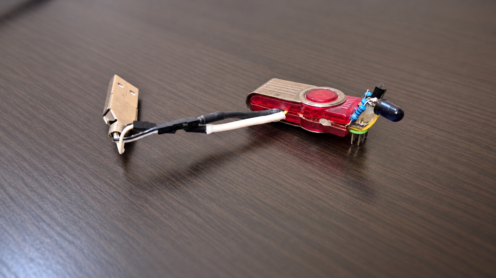
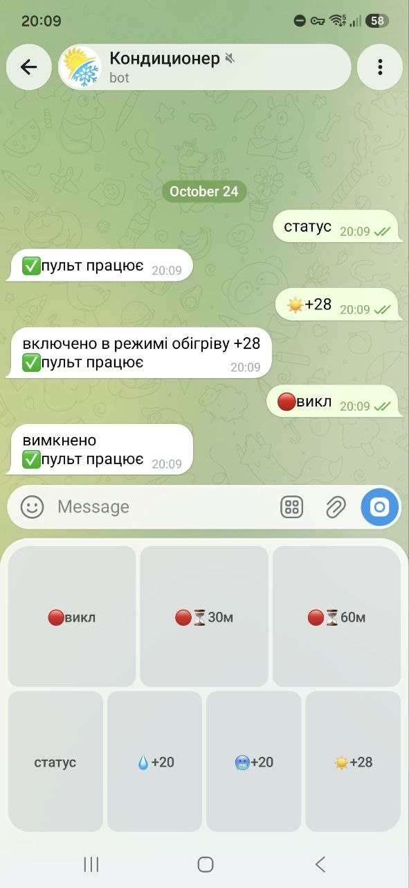

# IR Remote

**An air conditioner on Telegram. Rust on the server, ESP8266 by the appliance.**

[](https://github.com/vadikoom/ir-remote/actions/workflows/ci.yml)

This project connects my infrared air conditioner to Telegram. A Rust service handles buttons and timers, then sends
encrypted commands to an ESP8266 that emits the original remote’s IR signals.

Behind the buttons are command acknowledgements, bounded retries, connectivity tracking, and cancellation of replaced
timers. The repository includes the transmitter firmware and a separate tool for capturing the remote’s signals.

<table>
<tr>
<td width="70%" valign="top">

<p>The USB-powered transmitter. Tabletop retouched for presentation; original hardware design preserved.</p>
</td>
<td width="30%" valign="top">

<p>The bot in use: status, heating, and off commands.</p>
</td>
</tr>
</table>

## From chat to infrared


The bot offers cooling, heating, dehumidification, off timers, and transmitter connectivity status. Buttons and replies
use Ukrainian; the bundled signals target my Lessar/COOLIX air conditioner.

## Decisions behind the buttons

**Give commands a deadline.** UDP delivery can fail, so the backend retries a command at one-second intervals for up to
four seconds while waiting for the transmitter’s acknowledgement. A newer command supersedes the pending one; an offline
transmitter causes an immediate error. The firmware suppresses duplicate execution during its uptime.

**Make timer replacement explicit.** Off timers share a cancellation key. Setting a new timer replaces the previous one;
an immediate off command cancels a pending timer after its IR command succeeds. Timers live in memory and disappear
when the bot restarts.

**Keep appliance behavior in configuration.** The [YAML configuration](tgbot/config.yaml) defines buttons, triggers,
responses, and sequences of send, delay, and respond actions. The Rust interpreter executes those actions without
hardcoding the meaning of each appliance command. Configuration is embedded at build time.

**Check both ends of the wire.** Rust and firmware tests share encrypted packet fixtures. The suite also exercises
UDP retries and reconnects, timer replacement, authorization, and a local mock of the Telegram API. Firmware checks run
with address and undefined-behavior sanitizers and cover malformed packets, bounds, and authentication failures.

## Run it

You’ll need Docker, [Task](https://taskfile.dev), a Telegram bot token, and an ESP8266 with an IR transmitter circuit.

```sh
cp .env.example .env
# Fill in the bot token, allowed user IDs, Wi-Fi, server address, and shared key.
# Generate the shared key with: openssl rand -hex 32
task build
task image:run
```

The transmitter needs matching configuration and firmware. See [setup and development](docs/setup.md) for wiring pins,
building, flashing, local development, and optional deployment over SSH.

## Explore the project

| Component | Where to look |
| --- | --- |
| Telegram actions and cancellable timers | [Bot interpreter](tgbot/src/bot.rs) |
| UDP retries, acknowledgements, and connectivity | [Server state machine](tgbot/src/server/runner.rs) |
| Encrypted packet format and shared fixtures | [Rust crypto](tgbot/src/server/crypto.rs), [firmware checks](firmware/tests/security.cpp) |
| ESP8266 transmitter | [Controller firmware](firmware/controller/) |
| Independent Arduino Mega signal capture tool | [Capture device](firmware/tester/) |
| Container deployment over SSH | [Infrastructure](infra/) |

## Scope and guarantees

I maintain this for my own setup. Adapting it to another appliance requires capturing its IR timings and updating the
configuration. An acknowledgement confirms that the transmitter emitted a signal; the appliance provides no feedback.
Online status describes transmitter connectivity.

Device traffic uses XChaCha20-Poly1305 authenticated encryption with a shared key. Packet freshness is not guaranteed,
and duplicate suppression resets with the device. See [protocol and security](docs/protocol.md) for the wire format,
key handling, and replay limitations.

Project code is available under the [MIT license](LICENSE). Vendored Monocypher retains its
[upstream license notices](firmware/controller/src/monocypher/README.md).
